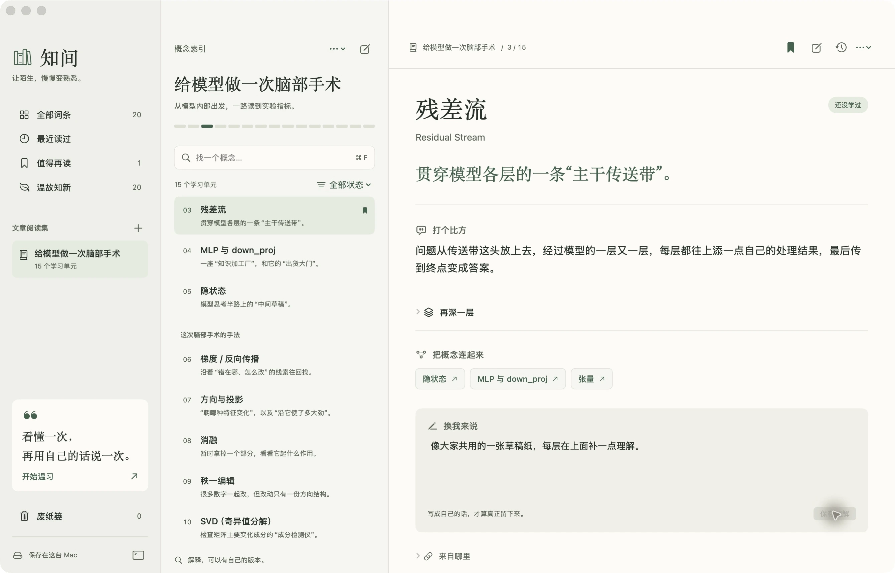

# 知间

一本原生 macOS 个人概念词典。把黑话翻译成大白话，留住文章语境，再用自己的话解释一次。



## 打开应用

从 [官网下载](https://harnessloom.com/zhijian/) 或 [GitHub Release](https://github.com/jokeuncle/zhijian/releases) 获取通用 DMG。预览版尚未经过 Apple 公证，首次打开步骤见 [安装说明](docs/INSTALL.zh-CN.txt)。下载后不需要开发环境。

开发者构建产物在 `build/知间.app`，双击即可打开，也可以运行：

```sh
scripts/run.sh
```

已有 15 个学习单元，按用户提供的四类与阅读顺序组织。checkpoint、safetensors、GGUF、vLLM、llama.cpp 另有独立词条供对比，因此完整词库共 20 条。初始解释根据用户笔记整理，并补充了比喻的边界；没有编造文章原文或链接。

## 日常使用

- 文章阅读集保留学习顺序；上方细条与正文底部可以前后跳转。
- 词条先展示一句话解释与比喻；技术细节、比喻边界和来源可以展开。
- 关联概念可直接跳转；“换我来说”保存自己的理解。
- 收藏、最近阅读、学习状态和全文搜索帮助找回概念。
- 温故知新先回想，再揭晓解释。选择还没懂 / 有点模糊 / 能讲明白，安排下次回看。
- 删除进入废纸篓；历史可恢复旧内容，保留当前学习进度。
- 废纸篓内可点击“清空废纸篓…”；确认后永久删除全部废纸篓词条及其历史，同时清理关联和阅读集引用，无法恢复。CLI 使用 `scripts/zhijian empty-trash --yes`。
- 左侧阅读集旁的加号可粘贴或导入 Markdown / JSON。JSON 备份保留词条、关系、个人笔记、学习状态与阅读集；Markdown 是便于阅读和迁移的文字导出。

点击词条顶部的书本按钮，或按 ⌘⇧L 进入专注阅读：正文居中，两侧导航收起，笔记按需展开。点击“返回词库”恢复三栏，⌘F 也会返回词库并开始搜索。词条总数只在列表上方显示一次。

阅读集支持独立搜索，以及最近阅读、最近收录和名称排序。每个阅读集分别记住词条、详情展开状态与滚动位置，重启后恢复上次的阅读现场。阅读偏好按词库 ID 隔离，使用系统 UserDefaults 保存；无需指定机器路径或配置个人账户。

| 快捷键 | 操作 |
|---|---|
| ⌘ N | 新建词条 |
| ⌘ F | 搜索 |
| ⌘ ↑ / ⌘ ↓ | 上一条 / 下一条（末尾自动加载下一页） |
| ⌘ ⇧ L | 进入 / 退出专注阅读 |
| ⌘ E | 编辑当前词条 |
| ⌘ D | 收藏 / 取消收藏 |
| ⌘ ⇧ I | 导入阅读笔记 |
| ⌘ ⇧ R | 温故知新 |
| ⌘ R | 刷新词库 |

## Codex / Agent 使用

CLI 和 MCP 都是正式数据入口，与桌面共用相同的数据规则。关闭窗口不影响工具操作。当前项目的 AGENTS.md 已提供操作说明，Codex 可以直接调用 CLI：

```sh
scripts/zhijian list --query '残差流'
scripts/zhijian get residual-stream
scripts/zhijian history residual-stream
scripts/zhijian collections
```

完整词条将文字放在 `content` 中，版本号为顶层 `revision`。新增和修改采用 JSON：

```sh
scripts/zhijian create --json - <<'JSON'
{"title":"注意力机制","english":"Attention","summary":"根据当前问题，决定要多关注哪些信息。","sourceTitle":"我的阅读笔记"}
JSON
```

修改前先读取词条，再传当前版本号，只写需要修改的字段：

```sh
scripts/zhijian update ENTRY_ID --revision CURRENT_REVISION --json - <<'JSON'
{"analogy":"读一段话时，把注意力放在最相关的几个词上。"}
JSON
```

`scripts/zhijian help` 列出删除、恢复、复习、历史还原、导入、导出与分页选项。

### MCP 连接

在应用左下角点击终端图标，可复制适合当前应用位置的连接命令。当前仓库的命令是：

```sh
codex mcp add zhijian -- "$PWD/scripts/zhijian" mcp
```

该命令会向当前用户的 Codex 注册本地工具；执行后可用 `codex mcp get zhijian` 检查。下载安装版请优先使用应用内生成的命令，并先把应用放到固定安装位置。仓库也提供 `.codex/config.toml`，供支持并信任项目配置的客户端使用；项目配置是否加载，以客户端实际结果为准。CLI 与 MCP 的实际 stdio 连接均有独立进程验收。

工具包括 `search_entries`、`get_entry`、`create_entry`、`update_entry`、`delete_entry`、`restore_entry`、`empty_trash`、`review_entry`、`list_collections`、`get_history`、`revert_entry`、`import_entries`、`library_stats`。现有词条的单条写操作需要 `expected_revision`；冲突会返回错误，避免覆盖其他窗口或 Agent 的新内容。`empty_trash` 仅用于用户明确要求永久清空时，须传 `confirm: true`。

Codex 的本地 MCP 配置与传输说明见 [OpenAI 官方文档](https://learn.chatgpt.com/docs/extend/mcp)。

## 数据与备份

默认位置：

```text
~/Library/Application Support/Zhijian/library.sqlite
```

从“学习 → 在访达中显示词库”可找到它。JSON 导出是跨进程一致的逻辑备份；建议使用应用导出，避免只复制正在使用的 `.sqlite` 而遗漏 WAL 中的新数据。备份恢复会保留已有 ID，遇到不同 ID 的同名活动词条会整批取消。

测试或维护其他词库时，可用 `--database PATH` 或环境变量 `ZHIJIAN_DATABASE`。第一次打开新库会导入初始内容；`--no-seed` 创建空词库。清空词库后不会再次自动填入初始内容。

## 构建与检查

用户运行需要 macOS 14+，不需要 Swift 工具链。开发者从源码构建需要 Swift；当前构建机器是 macOS 26.4.1 / Apple M5 / Swift 6.3.2。发布包包含 arm64 与 x86_64 二进制，Intel 已完成交叉编译与架构检查，尚未做 Intel 实机验收。应用使用系统 SwiftUI/AppKit/SQLite，无第三方依赖与运行时下载。

```sh
scripts/build.sh
.build/release/DictionaryChecks
python3 scripts/verify.py
scripts/zhijian benchmark --count 10000
scripts/release.sh
python3 scripts/verify-portable.py
```

本机 Command Line Tools 没有 XCTest / Swift Testing，所以行为测试是可独立运行的 Swift 程序，使用真实临时数据库验证状态，而非界面截图替代测试。Python 验收启动真实 CLI / MCP 子进程。

性能细节和实测结果见 [docs/performance.md](docs/performance.md)。设计与实现分别见 PRODUCT.md、DESIGN.md、Sources/DictionaryCore、Sources/ZhijianApp、Sources/ZhijianCLI。

首版专注本机单人使用；尚未实现云同步、全局热键浮窗或应用内自动生成解释。
